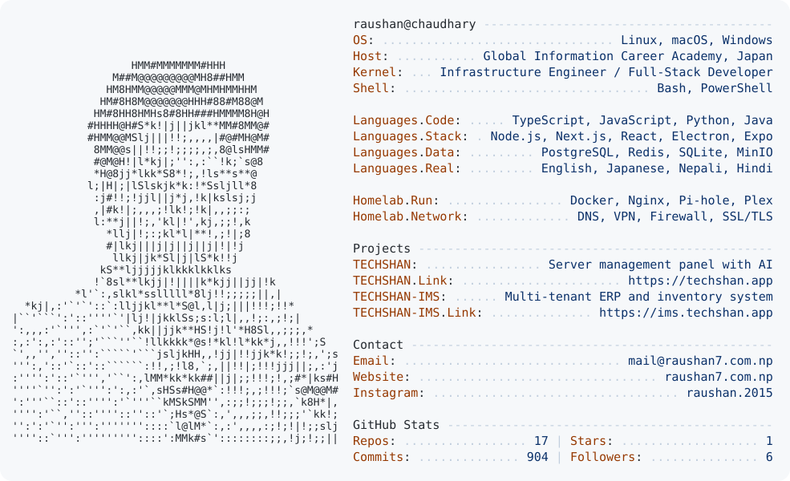
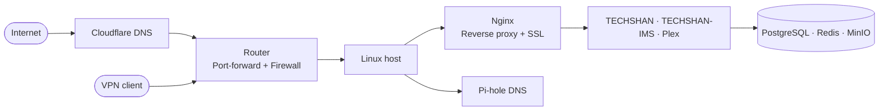

<a href="https://www.raushan7.com.np">
  <picture>
    <source media="(prefers-color-scheme: dark)" srcset="dark_mode.svg">
    
  </picture>
</a>

## Projects

### 🖥️ [TECHSHAN](https://techshan.app) · server management software

A panel for your own Linux server: manage almost everything on it from the browser instead of over SSH, or ask the built-in AI assistant to do it. It runs on your machine, and your data stays there.

| | |
|---|---|
| **Server** | Dashboard, Docker, KVM virtual machines with a browser console, files and SMB shares, storage pools, network, firewall, users, backups and a terminal |
| **AI** | AI Chat that runs commands on the server and asks before changing anything, the same from Telegram, one-click install of coding agents, shared skills |
| **Install** | One command, no Docker needed: `curl -fsSL https://techshan.app/install.sh \| sudo sh` |
| **Stack** | TypeScript · NestJS · Next.js · PostgreSQL · Redis · BullMQ · pnpm + Turborepo monorepo |

🔗 [techshan.app](https://techshan.app) · [github.com/raushan2015/techshan](https://github.com/raushan2015/techshan)

### 📦 [TECHSHAN-IMS](https://ims.techshan.app) · inventory management software

A multi-tenant ERP and inventory system for retail and wholesale businesses: double-entry accounting, POS, warehouse management, manufacturing, HR/payroll and a customer-facing storefront, in the shop's own language and currency.

| | |
|---|---|
| **Clients** | Web dashboard, tenant storefronts, marketplace, Electron desktop that works offline and syncs, Expo mobile app |
| **Backend** | 189 controllers · 140 services · public API with 122 routes · 64 integration test suites |
| **Database** | 339 tables · 141 migrations · PostgreSQL row-level security for tenant isolation |
| **Stack** | TypeScript · Node.js · Express · Next.js · React · PostgreSQL · Redis · BullMQ · MinIO · Electron · Expo · Docker |

🔗 [ims.techshan.app](https://ims.techshan.app)

## Home lab

TECHSHAN-IMS runs in production on a home lab I built and look after by myself: Linux, Docker, an Nginx reverse proxy with SSL/TLS, Pi-hole for DNS, VPN for remote access, with automated backups and deployments.

When something breaks I don't guess. I check layer by layer (process → port → DNS → router → ISP), fix it, write down what happened, and automate the fix.

## Education and certifications

| | |
|---|---|
| **Global Information Career Academy** (Japan) | Information Systems · 2025 – 2027 |
| **Tokyo Management College, Global Study Center** (Japan) | Japanese language · 2023 – 2025 |
| **Reliance International Academy** (Nepal) | +2 (Higher Secondary) · 2016 – 2018 |
| **TOEIC 835** · **JLPT N3** | 2024 |

  
  
  
  
  
  

